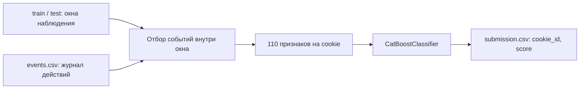
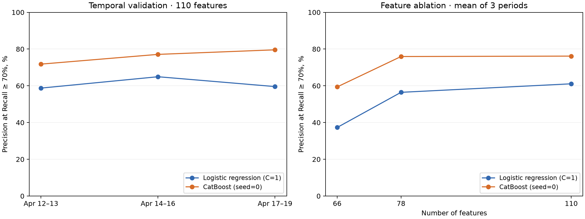

# Bot Detection — распознавание автоматизированного трафика

Классификация активности ботов и людей по журналу пользовательских событий. Проект выполнен на основе тестового задания **Avito**.

Главная часть решения — **построение признаков из событий**: исходный лог преобразуется в таблицу из **110 числовых признаков** на каждый `cookie_id`. На этих данных обучается CatBoost, который оценивает вероятность автоматизированной активности.

**Стек:** Python · pandas · NumPy · scikit-learn · CatBoost · Matplotlib · Jupyter Notebook

## Задача

По действиям пользователя в заданном временном окне нужно определить, относится ли его активность к ботам или людям. Для каждого объекта из тестовой выборки решение возвращает непрерывную оценку `score`: чем она выше, тем вероятнее автоматизированный трафик.

Единица классификации — **cookie в пределах окна наблюдения**, а не отдельное событие. Целевая переменная `target` принимает значения `0` для человека и `1` для бота.

В задании были предоставлены обучающая и тестовая выборки, а также журнал событий. Готовой матрицы признаков не было: её нужно было построить самостоятельно из `events.csv`.

## Данные

Исходные данные тестового задания Avito не включены в публичный репозиторий. Для полного запуска нужны собственные копии `train.csv`, `test.csv` и `events.csv`; разместите их в `data/`, как показано ниже. Итоговый `submission.csv` и прогнозы по отдельным объектам также остаются локальными. В репозитории опубликованы агрегированные метрики, график и параметры эксперимента. Без исходных данных можно собрать Docker-образ и запустить автоматические тесты.

| Файл | Содержимое | Объём |
| --- | --- | ---: |
| `train.csv` | Идентификатор cookie, дата её создания, границы окна и `target` | 11 091 объект |
| `test.csv` | Та же структура, без целевой переменной | 4 909 объектов |
| `events.csv` | Журнал действий, параметры клиента и координаты указателя | 328 905 событий |

Начала окон в train относятся к **6–19 апреля 2026 года**, в test — к **20–26 апреля 2026 года**. В `test.csv` нет меток: он используется для итогового прогнозирования и внешней оценки. Локальную валидацию можно проводить на размеченной части train, сохраняя порядок времени.

Журнал содержит время и тип события, платформу, User-Agent, сведения об объявлениях и поиске, координаты указателя. Среди действий — просмотр объявления, просмотр поисковой выдачи, добавление в избранное, открытие контактов и другие события.

## Как устроено решение



1. События связываются с метаданными по `cookie_id` и ограничиваются интервалом `[window_start_ts, window_end_ts)`.
2. Для каждой cookie рассчитываются поведенческие, контекстные и пространственные агрегаты.
3. Строки матрицы признаков выравниваются с метками по идентификатору.
4. Модель обучается на всём train и вычисляет вероятность класса `1` для test.
5. Прогнозы сохраняются в порядке строк исходной тестовой выборки.

### Построение признаков

| Группа | Количество | Примеры |
| --- | ---: | --- |
| Поведение | 58 | Число и доли разных действий, разнообразие объявлений и запросов, активные минуты и часы, интервалы между событиями, число сессий, глубина поиска, энтропия интересов |
| Контекст | 8 | Доли платформ, маркеры HTTP-библиотек и headless-браузеров в User-Agent, признаки нативного клиента и Firefox, возраст cookie |
| Базовые признаки указателя | 12 | Наличие координат, их разброс и повторяемость, статистики смещений, доля неподвижных переходов |
| Расширенные признаки указателя | 32 | Квантили и форма распределений координат, корреляция осей, расстояния и скорости между наблюдениями, направления перемещений |
| **Всего** | **110** | |

Эти признаки описывают интенсивность, регулярность и разнообразие активности. Например, повторяющиеся действия с короткими интервалами и однообразные позиции указателя могут быть полезны для различения автоматизированного и обычного поведения. Итоговое решение принимает модель по совокупности признаков.

### Обработка данных

- Полные дубликаты событий удаляются перед расчётом агрегатов.
- `cookie_id` используется для связывания таблиц и выравнивания строк; `target` — только для обучения. Оба поля исключены из признаков.
- Неопределённые агрегаты и бесконечные значения заменяются на `-1`. Отсутствие координат сохраняет смысл пропуска и не превращается в позицию `(0, 0)`.
- Смещения указателя рассчитываются только при положительном интервале между наблюдениями, не превышающем 30 минут. Переходы с неоднозначным порядком событий при одинаковых временных метках исключаются.
- Набор столбцов для типов событий фиксирован, чтобы структура признаков оставалась одинаковой для train и test.

Координаты в логе — отдельные наблюдения. Полученные смещения характеризуют расстояние между наблюдаемыми позициями, а не полную траекторию движения мыши.

## Модели

### Baseline — логистическая регрессия

В качестве базовой модели была выбрана **логистическая регрессия** — простой и интерпретируемый подход к бинарной классификации. Такой baseline служит отправной точкой для оценки информативности признаков и сравнения с более сложной моделью.

В [`benchmark.py`](benchmark.py) baseline реализован как `Pipeline(StandardScaler, LogisticRegression)`: L2-регуляризация, `C=1`, solver `lbfgs`, `max_iter=10000`, `tol=1e-5`. Дополнительно проверяются `C=0.1` и `C=10`. Масштабирование обучается только на обучающей части каждого разбиения; валидация проходит через уже обученный scaler. Такой порядок предотвращает утечку статистик валидации — см. [рекомендации scikit-learn](https://scikit-learn.org/stable/common_pitfalls.html#data-leakage).

### Итоговая модель — CatBoost

Для итогового решения используется градиентный бустинг CatBoost, который позволяет учитывать нелинейные зависимости и взаимодействия между поведенческими признаками. Обе модели сравниваются на одинаковых признаках, объектах и временных разбиениях, без весов классов и ресемплинга. В benchmark используется та же конфигурация CatBoost, что и в `solution.py`.

Используется одна модель `CatBoostClassifier` с фиксированными параметрами:

| Параметр | Значение |
| --- | ---: |
| `iterations` | 500 |
| `depth` | 7 |
| `learning_rate` | 0.05 |
| `l2_leaf_reg` | 10 |
| `random_seed` | 0 |

Все входные признаки числовые. Модель работает с агрегированной таблицей; категориальные поля исходного журнала представлены через количества, доли и статистики разнообразия.

## Метрика и оценка качества

Метрика задания — **максимальный Precision среди порогов, при которых Recall ≥ 70%**. Она оценивает, какая доля объектов, отмеченных как боты, действительно является ботами, при условии обнаружения хотя бы 70% всех ботов.

Реализация находится в [`metric.py`](metric.py). Она перебирает пороги по значениям `score` и обрабатывает одинаковые оценки одной группой. Это метрика качества ранжирования с ограничением на полноту; фиксированный порог `0.5` при формировании submission не применяется.

`solution.py` выполняет финальное обучение на всём train, а `benchmark.py` — локальную валидацию. Подтверждённая внешняя оценка именно этой версии в репозитории не зафиксирована. `submission.csv` содержит 4 909 прогнозов и соответствует результату исходного ноутбука.

## Сравнение моделей

### Протокол эксперимента

Используется расширяющееся обучающее окно: модель обучается на прошлом и проверяется на следующем временном периоде. Все обучающие окна должны завершиться не позже начала валидации. Cookie между обучением и валидацией не пересекаются.

| Разбиение | Обучение, апрель 2026 | Валидация, апрель 2026 | Объектов в обучении | Объектов в валидации |
| --- | --- | --- | ---: | ---: |
| 1 | 6–11 | 12–13 | 5 113 | 1 660 |
| 2 | 6–13 | 14–16 | 6 773 | 2 367 |
| 3 | 6–16 | 17–19 | 9 140 | 1 951 |

Всего **30 обучений**: 10 конфигураций × 3 периода.

- Основное сравнение: логистическая регрессия (`C=1`) и CatBoost (`seed=0`) на всех 110 признаках.
- Вклад признаков: для каждой модели сравниваются 66 поведенческих и контекстных признаков, 78 признаков с базовыми агрегатами указателя и полный набор из 110 признаков.
- Чувствительность к настройкам: `C ∈ {0.1, 1, 10}` для логистической регрессии и `seed ∈ {0, 1, 2}` для CatBoost на полном наборе признаков.

Модели обучаются заново для каждой конфигурации и периода. Статистики признаков считаются независимо для каждой cookie внутри её окна. `test.csv` не участвует в benchmark. Предупреждение о несходимости логистической регрессии останавливает эксперимент.

Кроме основной метрики сохраняются **Average Precision (AP)**, **ROC-AUC**, **Recall при FPR ≤ 1%** и **log loss**. AP суммирует precision по приращениям recall; это не трапецеидальная площадь под PR-кривой. Все метрики качества считаются после округления score до пяти значащих цифр, как в submission.

### Результаты на 110 признаках

Основное сравнение использует заранее заданные `C=1` и `seed=0`.

| Валидационный период | Логистическая регрессия: P@R≥70% | CatBoost: P@R≥70% |
| --- | ---: | ---: |
| 12–13 апреля | 58,74% | **71,79%** |
| 14–16 апреля | 64,93% | **77,09%** |
| 17–19 апреля | 59,57% | **79,58%** |
| **Среднее** | **61,08%** | **76,16%** |

CatBoost выше baseline на всех трёх периодах. Средняя разница составляет **15,07 процентного пункта**.

| Метрика, среднее по периодам | Логистическая регрессия | CatBoost |
| --- | ---: | ---: |
| Average Precision ↑ | 0,7177 | **0,7848** |
| ROC-AUC ↑ | 0,9189 | **0,9369** |
| Recall при FPR ≤ 1% ↑ | 54,85% | **61,26%** |
| Log loss ↓ | 0,1450 | **0,1235** |



### Вклад признаков указателя

В таблице — средний Precision при Recall ≥ 70% по трём периодам. Параметры моделей при добавлении признаков не меняются.

| Набор признаков | Логистическая регрессия | CatBoost |
| --- | ---: | ---: |
| 66: поведение и контекст | 37,32% | 59,39% |
| 78: + базовые признаки указателя | 56,44% | 75,93% |
| 110: + расширенные признаки указателя | 61,08% | 76,16% |

Основной прирост связан с 12 базовыми признаками указателя: **+19,13 п.п.** для логистической регрессии и **+16,54 п.п.** для CatBoost. Дополнительные 32 признака дают **+4,64 п.п.** и **+0,23 п.п.** соответственно.

Для CatBoost полный набор не выигрывает на каждом периоде: на последнем периоде 78 признаков дают **80,58%**, а 110 — **79,58%**. Поэтому результат поддерживает полезность признаков указателя, но не доказывает устойчивого преимущества всех 110 признаков. Вариант с 78 признаками заслуживает отдельной проверки на новых данных как более компактная модель.

### Чувствительность к настройкам

Все варианты ниже используют 110 признаков. Среднее и стандартное отклонение рассчитаны по трём временным периодам.

| Модель | Настройка | Средний P@R≥70% | Стандартное отклонение, п.п. |
| --- | --- | ---: | ---: |
| Логистическая регрессия | `C=0.1` | 58,68% | 3,15 |
| Логистическая регрессия | `C=1` | 61,08% | 3,36 |
| Логистическая регрессия | `C=10` | 59,91% | 6,49 |
| CatBoost | `seed=0` | 76,16% | 3,98 |
| CatBoost | `seed=1` | 76,95% | 1,11 |
| CatBoost | `seed=2` | 75,47% | 2,02 |

Ослабление регуляризации до `C=10` не улучшило основную метрику в среднем и увеличило её разброс между периодами. Средние результаты CatBoost при разных seed находятся в диапазоне **75,47–76,95%**. Это отдельные модели, а не ансамбль; основной результат и `solution.py` сохраняют `seed=0`.

### Стоимость вычислений

Среднее по трём периодам для полного набора из 110 признаков, до четырёх потоков CPU:

| Измерение | Логистическая регрессия (`C=1`) | CatBoost (`seed=0`) |
| --- | ---: | ---: |
| Обучение, секунды | 0,12 | 11,04 |
| Пакетное предсказание, мс на 1 000 объектов | 2,38 | 3,38 |

Построение трёх вложенных наборов признаков из журнала для размеченных объектов заняло **4,98 секунды** и выполнялось один раз для всех экспериментов. Логистическая регрессия заметно дешевле в обучении; у CatBoost выше качество, а разница в пакетном предсказании на этой машине существенно меньше. Время обработки сырых событий не входит в замеры предсказания.

### Ограничения оценки

Эти временные периоды использовались при разработке признаков и конфигурации CatBoost. Поэтому сравнение является локальным диагностическим экспериментом, а не независимой оценкой обобщающей способности. Проверка нескольких `C` и seed показывает чувствительность результата; автоматического выбора лучшей конфигурации по этим же периодам нет. Это не сравнение моделей после равного бюджета подбора гиперпараметров.

Precision при Recall ≥ 70% и Recall при FPR ≤ 1% используют пороги, найденные по меткам оцениваемого периода. Они характеризуют качество ранжирования, но не гарантируют эти показатели при переносе фиксированного порога в продакшен. Для такого переноса нужен отдельный период выбора порога и последующая проверка на новых данных.

Время обучения включает scaler для логистической регрессии, но не построение признаков. Время предсказания — медиана пяти прогретых пакетных вызовов, пересчитанная на 1 000 объектов; это не задержка одиночного запроса. Обоим алгоритмам выделяется до четырёх потоков. Показатели времени зависят от машины; окружение сохраняется вместе с результатами.

## Структура проекта

```text
.
├── README.md                 # Описание проекта
├── Dockerfile                # Python-окружение и запуск в контейнере
├── .dockerignore             # Состав контекста сборки
├── solution.py               # Признаки, обучение и формирование прогнозов
├── solution.ipynb            # То же решение в формате Jupyter Notebook
├── benchmark.py              # Временная валидация и сравнение моделей
├── metric.py                 # Метрика задания
├── requirements.txt          # Зафиксированные версии библиотек
├── submission.csv            # Итоговые прогнозы (локально, исключены из Git)
├── tests/
│   └── test_benchmark.py      # Проверки разбиений, признаков и preprocessing
├── results/                  # Метрики, график и параметры; прогнозы остаются локально
└── data/                     # Исходные данные (локально, исключены из Git)
    ├── train.csv
    ├── test.csv
    └── events.csv/
        └── events.csv        # Исходный журнал событий
```

Все функции подготовки признаков включены непосредственно в `solution.py` и ноутбук. Дополнительный модуль с признаками для запуска не нужен.

## Запуск

Для запуска нужны Python и исходные CSV из задания. Расположите данные по путям, указанным выше: текущий код читает журнал именно из `data/events.csv/events.csv`.

Из корня проекта создайте виртуальное окружение:

```bash
python -m venv .venv
```

Активируйте его в своей оболочке:

```powershell
# Windows PowerShell
.\.venv\Scripts\Activate.ps1
```

```bash
# Linux / macOS
source .venv/bin/activate
```

Установите зависимости и запустите решение:

```bash
python -m pip install -r requirements.txt
python solution.py
```

В `requirements.txt` зафиксированы NumPy `2.3.5`, pandas `3.0.1`, CatBoost `1.2.10`, scikit-learn `1.9.1`, Matplotlib `3.11.2`, SciPy `1.18.1` и threadpoolctl `3.7.0`. Сохранённый benchmark выполнен на Python `3.14.7`. Скрипт ищет данные относительно собственного расположения, обучает модель и перезаписывает `submission.csv` в папке проекта. Фиксированный seed и версии библиотек помогают воспроизводить результат при использовании тех же данных.

### Повторить сравнение

```bash
python benchmark.py --threads 4
```

Команда выполняет все 30 обучений и сохраняет результаты в `results/`. Для отдельного запуска с сохранением предыдущих результатов используйте `--output-dir results/new-run`; путь к данным можно задать через `--data-dir`.

| Артефакт | Содержимое |
| --- | --- |
| [`fold_metrics.csv`](results/fold_metrics.csv) | Качество и время каждой конфигурации на каждом периоде |
| [`summary.csv`](results/summary.csv) | Среднее, стандартное отклонение, минимум и максимум по трём периодам |
| [`splits.csv`](results/splits.csv) | Границы разбиений, объёмы и доли ботов |
| `predictions.csv.gz` (локально) | Прогнозы на валидации с метками, cookie, названием конфигурации и периода; создаются при запуске benchmark и не публикуются |
| [`metadata.json`](results/metadata.json) | Конфигурации, список признаков, версии библиотек, окружение и SHA-256 кода и данных |
| [`comparison.png`](results/comparison.png) | Сравнение по периодам и по наборам признаков |

Средние метрики — арифметическое среднее трёх периодов с одинаковым весом каждого периода. Стандартное отклонение описывает различия между периодами и не является доверительным интервалом. Прогнозы в архиве округлены точно так же, как при подсчёте метрик, поэтому показатели можно пересчитать без повторного обучения.

### Проверки

```bash
python -m unittest discover -s tests -v
```

Проверяются временные границы и незавершённые окна, отсутствие пересечения cookie, обучение scaler только на train, исключение будущих событий из признаков, обработка одинаковых score и округления. Импорт `solution.py` также проверяется на отсутствие чтения данных и запуска обучения.

### Запуск в Docker

Образ содержит Python 3.14, зависимости, код и тесты. Исходные данные, ноутбук и готовые результаты исключены из сборки через `.dockerignore`. Контейнер запускается от отдельного пользователя, а данные подключаются только для чтения через [bind mounts](https://docs.docker.com/engine/storage/bind-mounts/).

На Windows установите [Docker Desktop](https://docs.docker.com/desktop/setup/install/windows-install/) с WSL 2 и запустите его в режиме Linux containers. Если WSL ещё не установлен, выполните `wsl --install` в PowerShell от имени администратора и перезагрузите компьютер. Проверка готовности Docker: `docker run --rm hello-world`.

Соберите образ из корня проекта:

```bash
docker build -t bot-detection .
```

Во время сборки выполняются автоматические тесты, не требующие исходных данных. Базовый образ `python:3.14-slim-bookworm` фиксирует ветку Python и дистрибутив; его patch-версия может обновляться. Версии Python-пакетов указаны в `requirements.txt`.

**Windows PowerShell — обучение и сохранение submission:**

```powershell
New-Item -ItemType Directory -Force outputs | Out-Null
docker run --rm --mount "type=bind,source=$($PWD.Path)\data,target=/data,readonly" --mount "type=bind,source=$($PWD.Path)\outputs,target=/output" bot-detection
```

**Linux / macOS:**

```bash
mkdir -p outputs
docker run --rm --user "$(id -u):$(id -g)" --mount "type=bind,source=$(pwd)/data,target=/data,readonly" --mount "type=bind,source=$(pwd)/outputs,target=/output" bot-detection
```

Результат появится в `outputs/submission.csv` на компьютере и сохранится после удаления контейнера. Входные данные должны лежать в `data/` с той же структурой, что и при обычном запуске.

**Сравнение моделей в контейнере, PowerShell:**

```powershell
docker run --rm --mount "type=bind,source=$($PWD.Path)\data,target=/data,readonly" --mount "type=bind,source=$($PWD.Path)\outputs,target=/output" bot-detection python benchmark.py --data-dir /data --output-dir /output/benchmark --threads 4
```

На Linux / macOS используйте mounts и `--user` из команды выше с теми же аргументами `python benchmark.py`. Результаты нового benchmark сохранятся в `outputs/benchmark/`.

Тесты можно запустить отдельно:

```bash
docker run --rm bot-detection python -m unittest discover -s tests -v
```

Для запуска скрипта с произвольными путями без Docker также доступны аргументы:

```bash
python solution.py --data-dir data --output outputs/submission.csv
```

Сохранённые метрики в `results/` получены ранее на Windows; время работы в контейнере следует измерять отдельно. Контрольные суммы в `metadata.json` относятся к исходникам на момент эксперимента, до добавления аргументов командной строки в `solution.py`. Функции признаков и параметры модели при этой адаптации не менялись.

### Запуск ноутбука

Jupyter устанавливается отдельно от зависимостей модели:

```bash
python -m pip install jupyterlab
python -m jupyterlab solution.ipynb
```

Запускайте Jupyter из корня проекта и выполняйте ячейки последовательно: ноутбук использует текущую рабочую папку для поиска данных.

## Результат работы

Файл `submission.csv` содержит два столбца:

| Столбец | Описание |
| --- | --- |
| `cookie_id` | Идентификатор объекта из test |
| `score` | Оценка вероятности автоматизированной активности в диапазоне `[0, 1]` |

Оценки сохраняются с пятью значащими цифрами, без дополнительного столбца индекса. Результат можно использовать для внешней проверки или выбора порога классификации на размеченной валидационной выборке.
